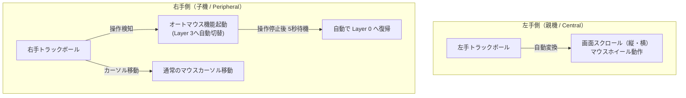

# KobitoKey_QWERTY

小人キーや人キーのケース、TypeSurfer各種の3DデータはReleasesよりダウンロード出来ます。
ダサい使い方はしないこと。


Layer 0 QWERTY


Layer 1 NUMBER & ARROW


Layer 2 Bluetooth & FUNCTION


Layer 3 AUTO MOUSE


---

## 📖 初心者向け 設定ファイル解説ドキュメント

このセクションでは、自作キーボード「小人キー」のキーマップやトラックボール設定をスムーズにカスタマイズできるよう、各設定ファイルのコード全文と行ごとの詳細な解説をまとめています。  
（※実際の設定ファイルの動作に影響が出ないよう、解説・コメントはすべてこのドキュメントに集約しています）

### 📑 目次
- [1. config/KobitoKey.json（GUI用物理レイアウト定義）](#1-configkobitokeyjson)
- [2. config/KobitoKey.keymap（キー割り当て・レイヤー・コンボ定義）](#2-configkobitokeykeymap)
  - [💡 レイヤー切り替えの仕組みと組み合わせ（&lt / &mo / &to / &tog）](#-レイヤー切り替えの仕組みと組み合わせlt--mo--to--tog)
  - [💡 コンボ（同時押し）の詳しい設定方法とカスタマイズ](#-コンボ同時押しの詳しい設定方法とカスタマイズ)
  - [💡 フルサイズキーボード キーコード早見表（ZMK設定用）](#-フルサイズキーボード-キーコード早見表zmk設定用)
  - [💡 初心者におすすめの定番カスタマイズ集（次期ブランチ用）](#-初心者におすすめの定番カスタマイズ集次期ブランチ用)
- [3. トラックボール設定ファイル群（左右センサー・スクロール・オートマウス）](#3-トラックボール設定ファイル群左右センサースクロールオートマウス)
  - [💡 トラックボールの全体像と左右の役割分担](#-トラックボールの全体像と左右の役割分担)
  - [💡 左手スクロールの初期設定と横スクロール活用法（3つの選択肢）](#-左手スクロールの初期設定と横スクロール活用法3つの選択肢)
  - [💡 1行ずつ精密にスクロールさせるチューニング（Excel・Word対策）](#-1行ずつ精密にスクロールさせるチューニングexcelword対策)
  - [💡 トラックボールの高度な設計とおすすめ拡張機能（スナイパーモード・片手操作）](#-トラックボールの高度な設計とおすすめ拡張機能スナイパーモード片手操作)
  - [💡 初心者向け：よくあるトラックボール調整方法（感度・スクロール・タイマー）](#-初心者向けよくあるトラックボール調整方法感度スクロールタイマー)
  - [3-1. KobitoKey_left.overlay（左手スクロール・オートマウス定義）](#3-1-kobitokey_leftoverlay)
  - [3-2. KobitoKey_right.overlay（右手カーソル移動・分割通信）](#3-2-kobitokey_rightoverlay)
  - [3-3. KobitoKey_left.conf（システム設定・LEDインジケーター）](#3-3-kobitokey_leftconf)
<!-- 今後追加予定:
- 4. config/boards/shields/KobitoKey/KobitoKey_right.conf（右手側システム設定）
- 5. config/boards/shields/KobitoKey/kobitokey.dtsi（共通ハードウェア・マトリクス定義）
-->

---

### 1. config/KobitoKey.json

- **編集・対象ファイル**: [`config/KobitoKey.json`](./config/KobitoKey.json)
- **ファイルの種類**: JSON (レイアウト定義)
- **ファイルの役割**: 
  - Nick Coutsos の「[Keymap Editor](https://nickcoutsos.github.io/keymap-editor/)」や「[ZMK Studio](https://zmk.studio/)」などの視覚的GUIエディタで、キーボードの物理的なキー配置（画面上の見た目）を正しく描画するための設定ファイルです。
  - **※注意**: 実際の「どのキーを押したら何の文字が出るか」というキー割り当ては [`config/KobitoKey.keymap`](./config/KobitoKey.keymap) に記述します。また、トラックボールの感度等の設定は `config/boards/shields/KobitoKey/` 配下にあります。

#### コード全文と解説（コメント付き）

```jsonc
{
  // キーボードの一意な識別子（ID）
  "id": "KobitoKey",

  // ツール等の画面上に表示されるキーボードの名称
  "name": "KobitoKey",

  // レイアウトの定義グループ
  "layouts": {
    // デフォルト（標準）レイアウトの定義
    "default_layout": {
      "name": "default_layout",

      // 各キーの物理配置リスト（全40キー：左右各20キー）
      // 【各項目の意味】
      //   row : スイッチマトリクスの行番号（0〜3行目）
      //   col : スイッチマトリクスの列番号（0〜9列目。0〜4が左手、5〜9が右手）
      //   x   : 画面上での横位置（1キー幅 = 1.0。左手と右手の間はトラックボール等を考慮し隙間が空いています）
      //   y   : 画面上での縦位置（1行下がるごとに +1.0）
      "layout": [
        // ----------------------------------------------------------------------
        // 【1行目 (最上段 / row: 0)】 全10キー
        // ----------------------------------------------------------------------
        // [左手側: row 0, col 0〜4] （KobitoKey.keymap では Q, W, E, R, T に対応）
        { "row": 0, "col": 0, "x":    0, "y": 0 }, // 左手小指 (例: Q)
        { "row": 0, "col": 1, "x":    1, "y": 0 }, // 左手薬指 (例: W)
        { "row": 0, "col": 2, "x":    2, "y": 0 }, // 左手中指 (例: E)
        { "row": 0, "col": 3, "x":    3, "y": 0 }, // 左手人差指 (例: R)
        { "row": 0, "col": 4, "x":    4, "y": 0 }, // 左手人差指 内側 (例: T)

        // [右手側: row 0, col 5〜9] （KobitoKey.keymap では Y, U, I, O, P に対応）
        // ※ xが4から6.5に飛んでいるのは、左右の間にトラックボール用の隙間（2.5キー分）があるため
        { "row": 0, "col": 5, "x":  6.5, "y": 0 }, // 右手人差指 内側 (例: Y)
        { "row": 0, "col": 6, "x":  7.5, "y": 0 }, // 右手人差指 (例: U)
        { "row": 0, "col": 7, "x":  8.5, "y": 0 }, // 右手中指 (例: I)
        { "row": 0, "col": 8, "x":  9.5, "y": 0 }, // 右手薬指 (例: O)
        { "row": 0, "col": 9, "x": 10.5, "y": 0 }, // 右手小指 (例: P)

        // ----------------------------------------------------------------------
        // 【2行目 (ホームポジション段 / row: 1)】 全10キー
        // ----------------------------------------------------------------------
        // [左手側: row 1, col 0〜4] （KobitoKey.keymap では A, S, D, F, G に対応）
        { "row": 1, "col": 0, "x":    0, "y": 1 }, // 左手小指 (例: A)
        { "row": 1, "col": 1, "x":    1, "y": 1 }, // 左手薬指 (例: S)
        { "row": 1, "col": 2, "x":    2, "y": 1 }, // 左手中指 (例: D)
        { "row": 1, "col": 3, "x":    3, "y": 1 }, // 左手人差指 (例: F)
        { "row": 1, "col": 4, "x":    4, "y": 1 }, // 左手人差指 内側 (例: G)

        // [右手側: row 1, col 5〜9] （KobitoKey.keymap では H, J, K, L, ; に対応）
        { "row": 1, "col": 5, "x":  6.5, "y": 1 }, // 右手人差指 内側 (例: H)
        { "row": 1, "col": 6, "x":  7.5, "y": 1 }, // 右手人差指 (例: J)
        { "row": 1, "col": 7, "x":  8.5, "y": 1 }, // 右手中指 (例: K)
        { "row": 1, "col": 8, "x":  9.5, "y": 1 }, // 右手薬指 (例: L)
        { "row": 1, "col": 9, "x": 10.5, "y": 1 }, // 右手小指 (例: ;)

        // ----------------------------------------------------------------------
        // 【3行目 (下段 / row: 2)】 全10キー
        // ----------------------------------------------------------------------
        // [左手側: row 2, col 0〜4] （KobitoKey.keymap では Z, X, C, V, B に対応）
        { "row": 2, "col": 0, "x":    0, "y": 2 }, // 左手小指 (例: Z)
        { "row": 2, "col": 1, "x":    1, "y": 2 }, // 左手薬指 (例: X)
        { "row": 2, "col": 2, "x":    2, "y": 2 }, // 左手中指 (例: C)
        { "row": 2, "col": 3, "x":    3, "y": 2 }, // 左手人差指 (例: V)
        { "row": 2, "col": 4, "x":    4, "y": 2 }, // 左手人差指 内側 (例: B)

        // [右手側: row 2, col 5〜9] （KobitoKey.keymap では N, M, ,, ., ' に対応）
        { "row": 2, "col": 5, "x":  6.5, "y": 2 }, // 右手人差指 内側 (例: N)
        { "row": 2, "col": 6, "x":  7.5, "y": 2 }, // 右手人差指 (例: M)
        { "row": 2, "col": 7, "x":  8.5, "y": 2 }, // 右手中指 (例: ,)
        { "row": 2, "col": 8, "x":  9.5, "y": 2 }, // 右手薬指 (例: .)
        { "row": 2, "col": 9, "x": 10.5, "y": 2 }, // 右手小指 (例: ')

        // ----------------------------------------------------------------------
        // 【4行目 (最下段・親指キーなど / row: 3)】 全10キー
        // ----------------------------------------------------------------------
        // [左手側: row 3, col 0〜4] （KobitoKey.keymap では LSHFT, LALT, LCMD, SPACE(LT2), LCTRL に対応）
        // ※ 親指キー等は手の自然な開きに合わせて x の配置が調整されています (2.5, 3.5, 4.5)
        { "row": 3, "col": 0, "x":    0, "y": 3 }, // 左端キー (例: Left Shift)
        { "row": 3, "col": 1, "x":    1, "y": 3 }, // 左から2番目 (例: Left Alt)
        { "row": 3, "col": 2, "x":  2.5, "y": 3 }, // 親指キー外側 (例: Left Cmd)
        { "row": 3, "col": 3, "x":  3.5, "y": 3 }, // 親指キー中央 (例: Space / タップでSpace, 長押しでLayer2)
        { "row": 3, "col": 4, "x":  4.5, "y": 3 }, // 親指キー内側 (例: Left Ctrl)

        // [右手側: row 3, col 5〜9] （KobitoKey.keymap では BSPC, ENTER(LT1), RSHFT, RSHFT, SLASH(LALT) に対応）
        { "row": 3, "col": 5, "x":    6, "y": 3 }, // 親指キー内側 (例: Backspace)
        { "row": 3, "col": 6, "x":    7, "y": 3 }, // 親指キー中央 (例: Enter / タップでEnter, 長押しでLayer1)
        { "row": 3, "col": 7, "x":    8, "y": 3 }, // 親指キー外側 (例: Right Shift)
        { "row": 3, "col": 8, "x":  9.5, "y": 3 }, // 右から2番目 (例: Right Shift)
        { "row": 3, "col": 9, "x": 10.5, "y": 3 }  // 右端キー (例: Slash / 長押しでLeft Alt)
      ]
    }
  },

  // ロータリーエンコーダー等の回転センサー定義（KobitoKeyでは未使用のため空配列）
  "sensors": []
}
```

---

### 2. config/KobitoKey.keymap

- **編集・対象ファイル**: [`config/KobitoKey.keymap`](./config/KobitoKey.keymap)
- **ファイルの種類**: DeviceTree / C形式（ZMK キーマップ定義ファイル）
- **ファイルの役割**: 
  - **キー設定の最重要ファイル**です。どのキーを押した時にどの文字を入力するか、同時押し（コンボ）で何が起きるか、長押しでどうレイヤーが切り替わるかなどを定義します。
  - キーボードのキーマップを変更したい場合は、主にこのファイルを編集します。

#### 💡 初心者向け：基本記法の読み方
| 記法 | 名称 | 動作・意味 | 例 |
| :--- | :--- | :--- | :--- |
| `&kp <キー>` | Key Press | 指定したキーを通常どおり入力する | `&kp A` (Aを入力), `&kp SPACE` |
| `&lt <レイヤー> <キー>` | Layer Tap | **タップでキー入力、長押しで指定レイヤーへ一時切り替え** | `&lt 1 ENTER` (タップでEnter、長押しでLayer 1) |
| `&mt <修飾キー> <キー>` | Mod Tap | **タップでキー入力、長押しで修飾キー（Shift/Alt等）** | `&mt LALT SLASH` (タップで/、長押しでAlt) |
| `&trans` | Transparent | **透過キー**。下のレイヤー（Layer 0など）のキー設定がそのまま使われる | `&trans` |
| `&to <レイヤー>` | To Layer | 指定したレイヤーへ恒久的に切り替える | `&to 0` (基本レイヤーに戻る) |
| `&bt <コマンド>` | Bluetooth | Bluetoothプロファイル切り替えやペアリング解除 | `&bt BT_SEL 0`, `&bt BT_CLR` |
| `&mkp <ボタン>` | Mouse Key Press | マウスクリック操作 | `&mkp MB1` (左クリック), `&mkp MB2` (右クリック) |

#### 💡 レイヤー切り替えの仕組みと組み合わせ（&lt / &mo / &to / &tog）

自作キーボードでは、キー数が少なくてもレイヤーを切り替えることでフルサイズキーボード以上のキー数を扱えます。ZMKには主に **4種類のレイヤー切り替え方式** が用意されています。

##### 1. レイヤー切り替え 4つの基本方式
| 記法 | 名称 | 動作・特徴 | 主な用途 |
| :--- | :--- | :--- | :--- |
| **`&lt <レイヤー> <キー>`** | **Layer Tap**<br/>*(小人キーで採用)* | **押している間だけ切り替え**（離すと戻る）。<br/>短くポンと押すと指定の文字を入力。 | 親指の Space や Enter との兼用（例: `&lt 2 SPACE`） |
| **`&mo <レイヤー>`** | **Momentary**<br/>(モメンタリー) | **押している間だけ切り替え**（離すと戻る）。<br/>※Shiftキーと同じで、単体タップでの文字入力はありません。 | 専用のレイヤー切り替えキーを用意したいとき |
| **`&to <レイヤー>`** | **To Layer**<br/>(トゥー) | **押すとそのレイヤーに完全に移動・固定**。<br/>指を離しても元のレイヤーには戻りません。 | ずっと数字だけ打ち続けたい「テンキー固定モード」や「ゲーム用レイヤー」など |
| **`&tog <レイヤー>`** | **Toggle**<br/>(トグル) | 押すたびに「そのレイヤーをON / OFF」切り替え（Caps Lockのような動作）。 | 特定のモードを1キーでON/OFF切り替えしたいとき |

##### 2. 「To Layer」と「Layer Tap」の組み合わせ活用例
「普段のファンクションキー（Layer 2）は **Layer Tap（長押し中だけ）** のままにして、長文の数字入力（Layer 1）だけを **To Layer（テンキー固定モード）** にする」といった組み合わせは非常に人気があります。

###### ⚠️ 超重要注意点：脱出ボタン（`&to 0`）の設定
`&to 1` で数字レイヤーに移動すると、指を離しても自動では戻りません。  
そのため、**移動先（Layer 1）のどこかのキーに必ず「`&to 0`（Layer 0に戻る）」を設定しておく必要があります**。これを忘れると、通常入力に戻れなくなってしまいます（レイヤー閉じ込め状態）。

> **💡 実例：小人キーの Layer 3 (MOUSE) もこの仕組みです**  
> トラックボールを動かすと自動でマウスレイヤーに入りますが、4行目に `&to 0` が配置されているため、親指を押すことで確実に通常レイヤー（Layer 0）へ戻れるよう設計されています。

###### 実装例（数字レイヤーを固定モードにする場合）
```c
// ■ Layer 0 (通常レイヤー)
// どこかのキー（またはコンボ）に「数字モード固定」を配置
&to 1        // ← これを押すと、指を離しても Layer 1（数字）に固定される！

// ■ Layer 1 (数字レイヤー)
// 必ず同じキー位置や分かりやすい位置に「脱出ボタン」を配置
&to 0        // ← これを押すと、通常レイヤー（Layer 0）に戻る！
```

##### 3. ワンキーで往復したいなら「`&tog`（トグル）」も便利
「戻るための専用キーを増やしたくない」「同じキーをもう一度押して戻りたい」という場合は、トグル（`&tog`）が便利です。
- **Layer 0**: `&tog 1` を配置
- **Layer 1**: 同じ位置のキーを `&trans`（透過）または `&tog 1` に設定
- **動作**: 1回押すと「数字モードON」、**もう一度同じキーを押すと「数字モードOFF（元のLayer 0に戻る）」** となり、1つのキーで往復できます。

#### 💡 キー番号（key-positions）の数え方
コンボ（同時押し）などで使われる `key-positions` は、全40キーに **左上から順に 0〜39** の番号が振られています：
- **0 〜 9** : 1行目（最上段：Q〜P）
- **10 〜 19** : 2行目（ホームポジション段：A〜;）
- **20 〜 29** : 3行目（下段：Z〜'）
- **30 〜 39** : 4行目（親指・最下段：Shift, Space, Enterなど）

#### 💡 コンボ（同時押し）の詳しい設定方法とカスタマイズ

コンボ機能を使うと、キー数の少ない小人キーでもホームポジションから手を離さずに様々なキーやショートカットを発動できます。

##### 1. 特定レイヤーでのみ発動させる（`layers` プロパティ）
コンボ設定に `layers` を指定しない場合、**すべてのレイヤーで常に有効**になります。  
「数字入力中（Layer 1）だけ別の動作をさせたい」「特定レイヤーでの誤爆を防ぎたい」場合は、`layers = <レイヤー番号>;` を指定します。キー位置番号（`key-positions`）は**どのレイヤーでも変わらず 0〜39** を指定します。

- **レイヤー番号の対応**:
  - `0` : Layer 0（デフォルト英字レイヤー）
  - `1` : Layer 1（NUMBER & ARROW レイヤー）
  - `2` : Layer 2（FUNCTION & Bluetooth レイヤー）
  - `3` : Layer 3（AUTO MOUSE レイヤー）

```c
combos {
    compatible = "zmk,combos";

    // 【例1: 単一レイヤー限定】 Layer 1（数字レイヤー）のときだけ発動
    // 物理キー位置 11 と 12（数字の 4 と 5）の同時押しで「!」を入力
    combo_exclamation {
        timeout-ms = <50>;
        key-positions = <11 12>;   // 物理キー位置 (0〜39)
        bindings = <&kp EXCL>;     // ! マーク
        layers = <1>;              // ★ Layer 1 にいる時だけ有効
    };

    // 【例2: ファンクションレイヤー限定】 Layer 2 のときだけ発動
    // 物理キー位置 0 と 1 の同時押しで特定操作を実行
    combo_layer2_shortcut {
        timeout-ms = <50>;
        key-positions = <0 1>;
        bindings = <&kp C_RESET>;  // リセット操作など
        layers = <2>;              // ★ Layer 2 にいる時だけ有効
    };

    // 【例3: 複数レイヤーで有効】 Layer 1 と Layer 2 の両方で有効
    // 物理キー位置 10 と 11 の同時押しで「: (コロン)」を入力
    combo_multi_layer {
        timeout-ms = <50>;
        key-positions = <10 11>;
        bindings = <&kp COLON>;
        layers = <1 2>;            // ★ 半角スペースで区切って複数指定
    };
};
```

##### 2. コンボの感度と誤爆防止（役立つ追加設定）
| プロパティ | 標準値 | 役割と調整のコツ |
| :--- | :--- | :--- |
| `timeout-ms` | `<50>` (50ms) | **同時押しの判定時間**。素早く打つのが難しくコンボが出にくい場合は `<60>`〜`<75>` に延ばします。逆に、通常のタイピング中に誤って同時押しと誤認されてしまう場合は `<40>`〜`<35>` に短くします。 |
| `require-prior-idle-ms` | (未指定) | **タイピング中の誤爆防止**。例として `require-prior-idle-ms = <150>;` と書くと、「直前のキー入力から150ミリ秒以上キーボードを打っていない時」だけコンボを受け付けます。アルファベット高速打鍵中の誤爆を防ぐのに非常に強力です。 |

##### 3. その他の応用テクニック
- **3キー以上の同時押し**:  
  `key-positions = <11 12 13>;` のように、3つ以上のキー番号を指定して「3キー同時押しコンボ」も作れます。
- **キー入力以外の割り当て**:  
  `bindings` には通常の文字 `&kp` だけでなく、レイヤー移動（`&mo 1`, `&to 0`）やマウスクリック（`&mkp MB1`）、Bluetooth操作なども自由に割り当て可能です。

#### 💡 フルサイズキーボード キーコード早見表（ZMK設定用）
キーマップを変更して新しいキーを割り当てたい場合は、以下のコードを `&kp` の後ろに指定します（例: `&kp ESC`, `&kp F5`）。

##### 1. macOS / Windows 共通キー
| 分類 | キー名 / 刻印 | ZMKキーコード | 補足説明 |
| :--- | :--- | :--- | :--- |
| **アルファベット** | A 〜 Z | `&kp A` 〜 `&kp Z` | 大文字はShiftキーと組み合わせて入力 |
| **数字 (メイン行)** | 0 〜 9 | `&kp N0` 〜 `&kp N9` | キーボード上部の数字キー (テンキーとは別) |
| **編集・制御** | Space (空白) | `&kp SPACE` | スペースバー |
| | Enter / Return | `&kp ENTER` | 改行 / 決定 |
| | Escape (Esc) | `&kp ESC` | キャンセル / エスケープ |
| | Tab | `&kp TAB` | タブ移動 / インデント |
| | Backspace | `&kp BSPC` | カーソル直前の文字を削除 |
| | Delete (Del) | `&kp DEL` | カーソル直後の文字を削除 |
| | Caps Lock | `&kp CAPS` | 英大文字入力のロック |
| **カーソル・移動** | 矢印キー (↑ ↓ ← →) | `&kp UP`, `&kp DOWN`, `&kp LEFT`, `&kp RIGHT` | 上下左右の移動 |
| | Home / End | `&kp HOME`, `&kp END` | 行頭 / 行末へのジャンプ |
| | Page Up / Page Down | `&kp PG_UP`, `&kp PG_DN` | 1ページ上 / 下へスクロール |
| | Insert | `&kp INS` | 挿入 / 上書きモード切り替え |
| **記号** | - (ハイフン) / _ (アンダーバー) | `&kp MINUS` / `&kp UNDER` | |
| | = (イコール) / + (プラス) | `&kp EQUAL` / `&kp PLUS` | |
| | [ ] (角括弧) | `&kp LBKT` / `&kp RBKT` | 左ブラケット / 右ブラケット |
| | { } (波括弧) | `&kp LBRC` / `&kp RBRC` | |
| | \ (バックスラッシュ) / \| (縦線) | `&kp BSLH` / `&kp PIPE` | |
| | ; (セミコロン) / : (コロン) | `&kp SEMI` / `&kp COLON` | |
| | ' (シングル) / " (ダブルクォート) | `&kp SQT` (または `&kp APOS`) / `&kp DQT` | アポストロフィ / 引用符 |
| | ` (バッククォート) / ~ (チルダ) | `&kp GRAVE` / `&kp TILDE` | |
| | , (カンマ) / < (小なり) | `&kp COMMA` / `&kp LT` | |
| | . (ピリオド) / > (大なり) | `&kp DOT` / `&kp GT` | |
| | / (スラッシュ) / ? (クエスチョン) | `&kp SLASH` (または `&kp FSLH`) / `&kp QMARK` | |
| | ! @ # $ % ^ & * ( ) | `&kp EXCL`, `&kp AT`, `&kp HASH`, `&kp DLLR`, `&kp PRCNT`, `&kp CARET`, `&kp AMPS`, `&kp ASTRK`, `&kp LPAR`, `&kp RPAR` | Shift不要で直接記号を入力したい時に指定可能 |
| **ファンクション** | F1 〜 F12 | `&kp F1` 〜 `&kp F12` | (F13〜F24も `&kp F13`〜 で利用可能) |
| **テンキー** | テンキー数字 0 〜 9 | `&kp KP_N0` 〜 `&kp KP_N9` | テンキー部の独立した数字コード |
| | テンキー四則演算 (+ - * /) | `&kp KP_PLUS`, `&kp KP_MINUS`, `&kp KP_MULTIPLY`, `&kp KP_DIVIDE` | |
| | テンキー Enter / 小数点 (.) | `&kp KP_ENTER`, `&kp KP_DOT` | |
| | Num Lock | `&kp KP_NUM` | テンキーの数値ロック切り替え |
| **音量・メディア** | 音量アップ / ダウン / ミュート | `&kp C_VOL_UP`, `&kp C_VOL_DN`, `&kp C_MUTE` | 音量の変更・消音 |
| | 再生・一時停止 / 次へ / 前へ | `&kp C_PLAY_PAUSE`, `&kp C_NEXT`, `&kp C_PREV` | 音楽・動画の再生制御 |
| | 画面輝度 (明るさ) アップ / ダウン | `&kp C_BRI_UP`, `&kp C_BRI_DN` | ディスプレイの明るさ調整 |

##### 2. 修飾キー（Modifier）の対応関係
修飾キーは OS（Mac / Windows）によって呼び名と役割が対応しています。

| キー | macOS での動作 | Windows での動作 | ZMKコード (汎用) | ZMKコード (OS別推奨) |
| :--- | :--- | :--- | :--- | :--- |
| **Shift** (左右) | Shift (シフト) | Shift (シフト) | `&kp LSHFT` / `&kp RSHFT` | (共通) |
| **Control** (左右) | Control (コントロール) | Ctrl (コントロール) | `&kp LCTRL` / `&kp RCTRL` | (共通) |
| **Option / Alt** (左右) | **Option (⌥)** | **Alt (オルト)** | `&kp LALT` / `&kp RALT` | Mac用: `&kp LOPT` / `&kp ROPT` |
| **Command / Windows** (左右) | **Command (⌘ / Cmd)** | **Windowsキー (⊞ / Win)** | `&kp LGUI` / `&kp RGUI` | Mac用: `&kp LCMD` / `&kp RCMD`<br/>Win用: `&kp LWIN` / `&kp RWIN` |

##### 3. macOS 特有のキー
| 機能 / キー名 | ZMKキーコード | 説明 |
| :--- | :--- | :--- |
| **英数キー** (JIS) | `&kp LANG2` | 日本語入力をOFF（英数）にする *(小人キーでは D+F の同時押しコンボに設定)* |
| **かなキー** (JIS) | `&kp LANG1` | 日本語入力をON（かな）にする *(小人キーでは J+K の同時押しコンボに設定)* |
| **Spotlight 検索** | `&kp LG(SPACE)` | Command + Space ショートカットを1つのキーで実行 |
| **Mission Control** | `&kp C_AC_DESKTOP_SHOW_ALL_WINDOWS` | 開いている全ウィンドウの一覧表示 |

##### 4. Windows 特有のキー
| 機能 / キー名 | ZMKキーコード | 説明 |
| :--- | :--- | :--- |
| **無変換キー** (JIS) | `&kp INT5` | 日本語入力の無変換 (確定前のカナ変換等) |
| **変換キー** (JIS) | `&kp INT4` | 日本語入力の変換キー |
| **半角/全角 (漢字)** | `&kp GRAVE` (または `&kp INT2`) | US配列認識時は `GRAVE`、JIS配列認識時は `INT2` で切り替え |
| **Print Screen** | `&kp PRINTSCREEN` (または `&kp PSCRN`) | 画面全体のスクリーンショット保存 |
| **Scroll Lock** | `&kp SLCK` | スクロールロック |
| **Pause / Break** | `&kp PAUSE_BREAK` | 処理の一時停止 |
| **アプリケーションキー** | `&kp K_APP` | 右クリックメニューを表示するキー (キーボード右下のメニューアイコン) |

---

#### コード全文と解説（コメント付き）

```c
// ==============================================================================
// 【1. ヘッダーファイルのインクルード】
// ZMK の標準機能やキーコード定義を取り込んでいます
// ==============================================================================
#include <input/processors.dtsi>     // トラックボールなどのポインティングデバイス処理
#include <behaviors.dtsi>            // タップ・長押し・ホールド等のキー動作定義
#include <dt-bindings/zmk/bt.h>      // Bluetooth操作用コマンド (BT_SEL, BT_CLR等)
#include <dt-bindings/zmk/keys.h>    // 一般キーコード定義 (kp Q, kp ENTER等)
#include <dt-bindings/zmk/pointing.h>// マウス操作用コード (mkp MB1等)

/ {
    // ==========================================================================
    // 【2. コンボ（同時押し）機能の定義】
    // 複数のキーをほぼ同時に押したときに、別のキー入力を発生させる便利設定です。
    // キー数が少ない40キーボードでは特に重宝します。
    // ==========================================================================
    combos {
        compatible = "zmk,combos";

        // 「英数」切り替えコンボ (Mac/Windows用)
        combo_eisu {
            timeout-ms = <50>;       // 50ミリ秒以内に同時に押す
            key-positions = <12 13>; // キー位置 12(D) と 13(F) を同時押し
            bindings = <&kp LANG2>;  // 「英数」キー (LANG2) を入力
        };

        // 「かな」切り替えコンボ (Mac/Windows用)
        combo_kana {
            timeout-ms = <50>;       // 50ミリ秒以内に同時に押す
            key-positions = <16 17>; // キー位置 16(J) と 17(K) を同時押し
            bindings = <&kp LANG1>;  // 「かな」キー (LANG1) を入力
        };

        // 「Escape」キーのコンボ
        combo_esc {
            timeout-ms = <50>;       // 50ミリ秒以内に同時に押す
            key-positions = <0 1>;   // キー位置 0(Q) と 1(W) を同時押し
            bindings = <&kp ESC>;    // 「Esc」キーを入力
        };

        // 「Tab」キーのコンボ
        combo_tab {
            timeout-ms = <50>;       // 50ミリ秒以内に同時に押す
            key-positions = <10 11>; // キー位置 10(A) と 11(S) を同時押し
            bindings = <&kp TAB>;    // 「Tab」キーを入力
        };
    };

    // ==========================================================================
    // 【3. キーマップ（レイヤー）の定義】
    // レイヤーごとに全40キー（4行 × 10列）の割り当てを記述しています。
    // ==========================================================================
    keymap {
        compatible = "zmk,keymap";

        // ----------------------------------------------------------------------
        // ■ Layer 0: default_layer（標準の英字入力レイヤー）
        // ----------------------------------------------------------------------
        default_layer {
            bindings = <
// [1行目: 最上段]
// 左手: Q, W, E, R, T                          | 右手: Y, U, I, O, P
&kp Q      &kp W     &kp E     &kp R        &kp T      &kp Y     &kp U        &kp I      &kp O      &kp P

// [2行目: ホームポジション段]
// 左手: A, S, D, F, G                          | 右手: H, J, K, L, ; (セミコロン)
&kp A      &kp S     &kp D     &kp F        &kp G      &kp H     &kp J        &kp K      &kp L      &kp SEMI

// [3行目: 下段]
// 左手: Z, X, C, V, B                          | 右手: N, M, , (カンマ), . (ピリオド), ' (シングルクォート)
&kp Z      &kp X     &kp C     &kp V        &kp B      &kp N     &kp M        &kp COMMA  &kp DOT    &kp APOS

// [4行目: 親指・修飾キー段]
// 左手: 左Shift, 左Alt, 左Cmd, [長押しLayer2 / 短押しSpace], 左Ctrl
// 右手: Backspace, [長押しLayer1 / 短押しEnter], 右Shift, 右Shift, [長押しLeft Alt / 短押し /]
&kp LSHFT  &kp LALT  &kp LCMD  &lt 2 SPACE  &kp LCTRL  &kp BSPC  &lt 1 ENTER  &kp RSHFT  &kp RSHFT  &mt LALT SLASH
            >;
        };

        // ----------------------------------------------------------------------
        // ■ Layer 1: layer1 [NUMBER]（数字テンキー ＆ 矢印・記号レイヤー）
        // Space右側の「Enter（lt 1 ENTER）」を長押ししている間、このレイヤーになります。
        // ----------------------------------------------------------------------
        layer1 {
            label = "NUMBER";
            bindings = <
// [1行目]
// 左手: 0, 1, 2, 3, (透過)                     | 右手: - (マイナス), (透過), ↑ (上矢印), (透過), (透過)
&kp N0     &kp N1  &kp N2  &kp N3     &trans  &kp MINUS  &trans     &kp UP    &trans     &trans

// [2行目]
// 左手: = (イコール), 4, 5, 6, (透過)          | 右手: + (プラス), ← (左矢印), ↓ (下矢印), → (右矢印), (透過)
&kp EQUAL  &kp N4  &kp N5  &kp N6     &trans  &kp PLUS   &kp LEFT   &kp DOWN  &kp RIGHT  &trans

// [3行目]
// 左手: (透過), 7, 8, 9, (透過)                | 右手: * (アスタリスク), / (スラッシュ), [ (開き角括弧), ] (閉じ角括弧), (透過)
&trans     &kp N7  &kp N8  &kp N9     &trans  &kp ASTRK  &kp SLASH  &kp LBKT  &kp RBKT   &trans

// [4行目]
// 左手: (透過), (透過), (透過), 左Shift, (透過)| 右手: (すべて透過：Layer 0のキーがそのまま効きます)
&trans     &trans  &trans  &kp LSHFT  &trans  &trans     &trans     &trans    &trans     &trans
            >;
        };

        // ----------------------------------------------------------------------
        // ■ Layer 2: layer2 [FUNCTION]（Bluetooth接続 ＆ ファンクションキー）
        // 左手親指の「Space（lt 2 SPACE）」を長押ししている間、このレイヤーになります。
        // ----------------------------------------------------------------------
        layer2 {
            label = "FUNCTION";
            bindings = <
// [1行目]
// 左手: Bluetooth接続先 1〜5番の切り替え        | 右手: F1 〜 F5
&bt BT_SEL 0  &bt BT_SEL 1  &bt BT_SEL 2  &bt BT_SEL 3  &bt BT_SEL 4    &kp F1   &kp F2   &kp F3  &kp F4  &kp F5

// [2行目]
// 左手: (透過), (透過), (透過), (透過), 現在のBTペアリング消去 | 右手: F6 〜 F10
&trans        &trans        &trans        &trans        &bt BT_CLR      &kp F6   &kp F7   &kp F8  &kp F9  &kp F10

// [3行目]
// 左手: (透過), (透過), (透過), (透過), 全BTペアリング消去   | 右手: F11, F12, (透過), (透過), (透過)
&trans        &trans        &trans        &trans        &bt BT_CLR_ALL  &kp F11  &kp F12  &trans  &trans  &trans

// [4行目]
// 左手: (すべて透過)                           | 右手: Deleteキー, (残り透過)
&trans        &trans        &trans        &trans        &trans          &kp DEL  &trans   &trans  &trans  &trans
            >;
        };

        // ----------------------------------------------------------------------
        // ■ Layer 3: layer3 [MOUSE]（トラックボール操作用マウスレイヤー）
        // トラックボールを動かした際に自動的（AUTO MOUSE）に呼び出されるレイヤーです。
        // ----------------------------------------------------------------------
        layer3 {
            label = "MOUSE";
            bindings = <
// [1行目]
// 左手: (透過)                                 | 右手: (透過), 左クリック (MB1), 中クリック/ホイール (MB3), 右クリック (MB2), (透過)
&trans     &trans  &trans    &trans    &trans  &trans  &mkp MB1  &mkp MB3  &mkp MB2  &trans

// [2行目]
// 左手・右手: すべて透過（Layer 0の通常キーがそのまま効きます）
&trans     &trans  &trans    &trans    &trans  &trans  &trans    &trans    &trans    &trans

// [3行目]
// 左手・右手: すべて透過
&trans     &trans  &trans    &trans    &trans  &trans  &trans    &trans    &trans    &trans

// [4行目]
// 左手: 左Shift, (透過), 左Cmd, 左Alt, [Layer 0に戻る] | 右手: (透過), (透過), (透過), [Layer 0に戻る], 右Alt
&kp LSHFT  &trans  &kp LCMD  &kp LALT  &to 0   &trans  &trans    &trans    &to 0     &kp RALT
            >;
        };
    };
};
```

---

#### 💡 初心者におすすめの定番カスタマイズ集

おすすめの定番カスタマイズ設定です。

##### カスタマイズ 1: スペース・Enterの連打誤爆防止（クイックタップ）
親指の `&lt 2 SPACE` や `&lt 1 ENTER` は、文章入力中に「スペースを素早く連打」したときに長押し判定と誤認されてレイヤーが変わってしまうことがあります。  
これを防ぐために、`KobitoKey.keymap` の `/ {` の中に以下のような `behaviors` 定義を追加すると、200ミリ秒以内の連打は必ず文字入力として扱われるようになります。

```c
/ {
    behaviors {
        // 連打対応のカスタムレイヤータップ (Space用)
        lt_spc: layer_tap_space {
            compatible = "zmk,behavior-hold-tap";
            #binding-cells = <2>;
            flavor = "balanced";
            tapping-term-ms = <200>;
            quick-tap-ms = <200>; // ★ 200ms以内の再タップは必ずSpace入力にする！
            bindings = <&mo>, <&kp>;
        };
    };

    keymap {
        // default_layer の Space 部分を書き換え
        // &lt 2 SPACE  →  &lt_spc 2 SPACE
    };
};
```

##### カスタマイズ 2: 数字レイヤー固定（テンキーモード）の実装
大量の数値を入力する際、親指を押し続けなくてもいいように「数字レイヤー固定モード」を作る設定例です。

###### 1. 入る時（コンボで固定化）
例えば左手最上段の `E` と `R`（位置 2 と 3）の同時押しで `Layer 1` に移動・固定します。
```c
combos {
    combo_num_lock {
        timeout-ms = <50>;
        key-positions = <2 3>; // E と R の同時押し
        bindings = <&to 1>;    // 数字レイヤーへ移動して固定
    };
};
```

###### 2. 戻る時（脱出ボタンの設定）と設計のポイント
> **⚠️ 重要な動作ルール**:  
> `&to 0` が配置されたキーを押すと、**文字入力（SpaceやEnter）は発生せず、「Layer 0に戻る」動作だけが実行されます**。  
> 逆に `&trans`（透過）と書かれたキーは、下の Layer 0 のキー（BackspaceやShiftなど）がそのまま通常通り発現します。

**【おすすめ設計：数字入力中もSpaceやEnterを通常通り打ちたい場合】**  
数字入力の最中に改行（Enter）や空白（Space）を打つ機会は非常に多いため、親指の Enter や Space はそのまま使えるように残し、**脱出ボタン（`&to 0`）を「左上端のキー」や「専用コンボ」に割り当てる**のが最も実用的でおすすめです。

```c
layer1 {
    label = "NUMBER";
    bindings = <
// 1行目: 左上端（普段のQの位置）を「Layer 0 への脱出ボタン（&to 0）」にする
&to 0      &kp N1  &kp N2  &kp N3     &trans  | &kp MINUS  &trans     &kp UP    &trans     &trans
&kp EQUAL  &kp N4  &kp N5  &kp N6     &trans  | &kp PLUS   &kp LEFT   &kp DOWN  &kp RIGHT  &trans
&trans     &kp N7  &kp N8  &kp N9     &trans  | &kp ASTRK  &kp SLASH  &kp LBKT  &kp RBKT   &trans

// 4行目: 親指の Space や Enter を通常通り打てるように設定
// これにより、数字入力中も普通にスペースやEnter、Backspaceが使えます！
&trans     &trans  &trans  &kp SPACE  &trans  | &kp BSPC   &kp ENTER  &trans    &trans     &trans
    >;
};
```
- この設定なら、数字を打ちながら何回スペースや改行（Enter）を挟んでも数字モードが解除されず、数値入力が終わったときだけ左上の `&to 0` を押して通常入力に復帰できます。

##### カスタマイズ 3: ホームポジション・モディファイア（HRM）
最下段まで小指を伸ばさずに、ホームポジション（`A, S, D, F` / `J, K, L, ;`）を長押しするだけで `Shift`, `Ctrl`, `Alt`, `Cmd` を発動させる、小型キーボードで最も人気の高い入力方式です。
```c
// 例: 通常押しで文字、長押しで修飾キー
&mt LCMD A   // タップで A、長押しで Command (⌘)
&mt LALT S   // タップで S、長押しで Option (⌥)
&mt LCTRL D  // タップで D、長押しで Control (⌃)
&mt LSHFT F  // タップで F、長押しで Shift (⇧)
```

---

### 3. トラックボール設定ファイル群（左右センサー・スクロール・オートマウス）

小人キーの最大の特徴である「両手トラックボール」は、ハードウェア定義ファイル（`overlay`）とシステム設定ファイル（`conf`）によって制御されています。

#### 💡 トラックボールの全体像と左右の役割分担

小人キーでは、左右のトラックボールにそれぞれ別の役割が与えられています：



- **左手トラックボール**: **「スクロール専用」**（上下スクロール）。Webページやコードの閲覧時にマウスホイールとして機能します（※横スクロールは誤爆防止のためデフォルトで0倍に設定）。
- **右手トラックボール**: **「マウスカーソル移動 ＆ オートマウス」**。ボールを動かすと自動的に `Layer 3 (MOUSE)` に切り替わり、マウスボタン（左クリック・右クリック）が打てるようになります。ボール操作を止めて5秒経つと自動で通常レイヤーに戻ります。

---

#### 💡 左手スクロールの初期設定と横スクロール活用法（3つの選択肢）

##### デフォルトの動作と考慮されていること
- **デフォルト設定**: `zip_x_scaler 0 1`（横感度 0倍）/ `zip_y_scaler 1 15`（縦感度 1/15倍）
- **考慮されていること（作者の意図）**:  
  Webページや長文を縦に快適にスクロールしたい時、ボールが少しでも斜めに転がると画面が左右にガタガタ揺れる「横スクロール誤爆」が発生します。これを防ぐため、あえて横方向の感度を 0 に潰し、**「快適な縦スクロール専用ホイール」** として設計されています。

##### 横スクロールを使いたい時のおすすめアプローチ

| アプローチ | 設定難易度 | メリット・デメリット |
| :--- | :--- | :--- |
| **① OS標準のShift押しスクロール** | ★☆☆☆☆ (設定不要) | **Shiftを押しながら左手ボールを転がすだけでOS側で横スクロールになる**。キーボードの設定変更が一切不要で一番手軽。 |
| **② 常時、縦も横も有効化する** | ★★☆☆☆ (簡単) | `zip_x_scaler 0 1` を `1 15` に書き換えるだけ。斜めに転がすと誤爆しやすい点に注意が必要。 |
| **③ 【おすすめ】特定キーを押している間だけ「横スクロール専用」にする** | ★★★☆☆ (中級) | 普段は縦スクロール専用のまま、**指定キー（例: Fキーや親指キー）を押している間だけ「横スクロール専用（縦0倍/横有効）」に切り替える**。誤爆が完全にゼロになる最強の設定。 |

###### 【解説】③の「特定キーを押している間だけ横スクロール」の仕組み
ZMKでは、**「特定のレイヤーにいる時だけ、トラックボールの入力設定（input-processors）を上書きする」** ことができます。  
例えば「Layer 4（横スクロールレイヤー）」を作り、そこにいる時だけ縦横の比率を逆転させます。

1. **`KobitoKey_left.overlay` にレイヤー上書き定義を追加**:
   ```dts
   &tb_left_listener {
       // 通常時: 縦スクロールのみ（X: 0倍, Y: 1/15倍）
       input-processors = <&sensor_rotation_left>, <&zip_x_scaler 0 1>, <&zip_y_scaler 1 15>, <&zip_xy_to_scroll_mapper>, ...;

       // ★ Layer 4 にいる時だけ縦横を逆転させる上書き設定！
       h_scroll_override {
           layers = <4>; // Layer 4
           input-processors =
               <&sensor_rotation_left>,
               <&zip_x_scaler 1 15>, // ★ 横スクロールを有効化！
               <&zip_y_scaler 0 1>,  // ★ 縦スクロールを0倍（停止）！
               <&zip_xy_to_scroll_mapper>,
               <&zip_scroll_transform INPUT_TRANSFORM_Y_INVERT>,
               <&zip_scroll_transform INPUT_TRANSFORM_X_INVERT>;
       };
   };
   ```
2. **`KobitoKey.keymap` の Layer 3（MOUSE）に切り替えキーを配置**:
   - 例えば Layer 3 の `F` キーの位置や親指キーに **`&mo 4`**（押している間だけ Layer 4 に切り替え）を設定します。
   - **動作**: 普段は快適な縦スクロール。`F` キーを押しっぱなしにしている間だけ、縦がピタッと止まり「横スクロール専用」に変化します！

---

#### 💡 1行ずつ精密にスクロールさせるチューニング（Excel・Word対策）

「ボールを触った瞬間に素早く反応（高レスポンス）してほしいが、ExcelやWordで一気に2〜3行すっ飛んでしまうのを防ぎ、1行ずつ精密にコトコト動かしたい」という場合のチューニング方法です。

##### なぜ「少し触っただけで複数行ジャンプする」のか？
1. **OSの標準仕様（特にWindows）**: Windowsは初期状態で「ホイール1ノッチで **3行スクロール**」する設定になっています。キーボード側が正しく1スクロール分を送っても、Excel側が勝手に3行飛ばしてしまいます。
2. **CPI（感度）とスケーラーの不均衡**: `cpi = <200>` は感度が低めのため、ボールの動き出しにわずかな「遊び（不感帯）」があり、動き始めた瞬間に溜まった移動量が複数行分としてドバッと送信されてしまいます。

##### 3つの解決策（黄金比チューニング）

###### 解決策 1: ZMKの「高解像度 × 細分化」チューニング（黄金比）
> **`cpi`（センサー解像度）を上げて初動をキビキビさせ、`zip_y_scaler`（割り算の分母）を大きくして1歩の移動幅を細かく刻む！**

[`config/boards/shields/KobitoKey/KobitoKey_left.overlay`](./config/boards/shields/KobitoKey/KobitoKey_left.overlay) を以下のように調整します：

```dts
// ① センサー解像度を上げる（200 → 400〜600）
// ボールに指が触れた瞬間の極小の動きを即座に感知し、初動のモタつきが消えます
cpi = <400>; // または <600>

// ② 縦スクロールのスケーラーの分母を大きくする（15 → 30〜45）
// センサーが細かく拾った動きを「より小さく分割して」PCに送るため、1回で進む行数を最小限に抑えます
<&zip_y_scaler 1 35>, // 数字を大きくするほど、1歩が細かく（小さく）なります
```

###### 解決策 2: 高解像度スムーズスクロール機能（ZMK最新仕様）の有効化
マウスホイールの粗いカチカチ動作ではなく、トラックパッドのような「ピクセル単位の滑らかなスクロール」をOSに送る機能です。  
[`config/boards/shields/KobitoKey/KobitoKey_left.conf`](./config/boards/shields/KobitoKey/KobitoKey_left.conf) に以下の **1行** を書き加えます：

```ini
# 高解像度スムーズスクロールの有効化
CONFIG_ZMK_POINTING_SMOOTH_SCROLLING=y
```
- **効果**: ExcelやWord、ブラウザなどで、行単位のジャンプではなく「吸い付くような微細スクロール」ができるようになります。

###### 解決策 3: OS側（Windows / Mac）のスクロール設定
- **Windows**: 「設定」→「Bluetoothとデバイス」→「マウス」を開き、**「一度にスクロールする行数」を標準の `3` から `1` に変更** します。（※これだけでExcelやWordが確実に1行ずつ動くようになります！）
- **macOS**: 「システム設定」→「マウス」で「スクロールの速さ」を少し左（遅め）に調整します。

---

#### 💡 トラックボールの高度な設計とおすすめ拡張機能（スナイパーモード・片手操作）

小人キーのトラックボール制御には、作者による見事な工夫がすでに仕込まれており、さらに発展させるための拡張機能も用意されています。

##### 1. 【設定済みの神設計】なぜ `excluded-positions` に `6, 7, 8` が入っているのか？
`KobitoKey_left.overlay` の末尾にある `excluded-positions`（除外キーリスト）には、以下のキー番号が指定されています：
- **`6` (右手U位置)** : Layer 3 では **`&mkp MB1`（左クリック）**
- **`7` (右手I位置)** : Layer 3 では **`&mkp MB3`（中クリック/ホイール）**
- **`8` (右手O位置)** : Layer 3 では **`&mkp MB2`（右クリック）**
- **`30, 32, 33, 39`** : `LShift`, `LCmd`, `Space`, `Slash`

> **💡 設計意図**:  
> もしこれらが除外されていないと、**「ファイルをドラッグ＆ドロップしている最中（クリック長押し中）」に5秒タイマーが切れて通常レイヤーに戻り、クリックが勝手に外れてしまう大惨事** が起きます。  
> マウスボタン自身を除外リストに登録しておくことで、「クリック長押し中は安心してドラッグ操作を続けられる」という完璧な配慮がなされています。

##### 2. 【未設定の超便利機能 ①】スナイパーモード（精密ポインティング）
普段は `cpi = <600>` で画面端まで素早くカーソルを動かせますが、細かい画像編集やテキストの1文字選択、細いリンクのクリック時に「行き過ぎてしまって合わせづらい」ことがあります。

- **スナイパーモードの仕組み**:  
  指定したキー（例: 親指キーや右クリック横のキー）を押している間だけ、カーソル速度を **1/3 や 1/4（例: 150〜200 CPI相当）にスローダウン** させます。
- **実装イメージ（`KobitoKey_left.overlay` 内の上書き設定）**:
  ```dts
  // スナイパーレイヤー（例: Layer 5）にいる間だけ速度を 1/4 に落とす
  sniper_mode {
      layers = <5>;
      input-processors = <&sensor_rotation_right>, <&zip_xy_scaler 1 4>;
  };
  ```
  ボールを大きく転がしてもカーソルがピタピタと吸い付くように精密移動するため、クリエイティブ作業などで絶大な効果を発揮します。

##### 3. 【未設定の超便利機能 ②】右手だけの「片手ブラウジング（右手スクロール）」
小人キーは通常「左手でスクロール、右手でカーソル移動」の分担ですが、片手だけでWebサイトやSNSを流し見したいときに便利な機能です。

- **右手スクロールの仕組み**:  
  右手側にあるキーを押している間だけ、**右手トラックボールの移動を一時的に「スクロールホイール」に切り替えます**。
- **実装イメージ**:
  ```dts
  // 片手スクロールレイヤーにいる間、右手ボールをスクロールに変換
  r_scroll_mode {
      layers = <5>;
      input-processors = <&sensor_rotation_right>, <&zip_xy_to_scroll_mapper>;
  };
  ```
  片手だけで「カーソル移動」「クリック」「スクロール」の全操作が完結するため、リラックス時のブラウジングが極めて快適になります。

---

#### 💡 初心者向け：よくあるトラックボール調整方法（感度・スクロール・タイマー）

「トラックボールの動きを自分好みに調整したい！」という時は、以下の表を参考に該当ファイルの数値を変更します。

| やりたいこと | 対象ファイル | 変更する箇所（プロパティ） | 調整の目安 |
| :--- | :--- | :--- | :--- |
| **右手のカーソル速度を変えたい** | [`KobitoKey_right.overlay`](./config/boards/shields/KobitoKey/KobitoKey_right.overlay) | `cpi = <600>;` | 速くしたい: `800`〜`1000`<br/>遅くしたい: `300`〜`400` |
| **左手の横スクロールを常に有効にしたい** | [`KobitoKey_left.overlay`](./config/boards/shields/KobitoKey/KobitoKey_left.overlay) | `<&zip_x_scaler 0 1>` | `0 1` を `1 15` に変更する |
| **左手のスクロール速度を変えたい** | [`KobitoKey_left.overlay`](./config/boards/shields/KobitoKey/KobitoKey_left.overlay) | `<&zip_y_scaler 1 15>` | `1 15` の `15` を大きくすると遅く、小さくすると速くなる |
| **スクロールの向きを逆にしたい** | [`KobitoKey_left.overlay`](./config/boards/shields/KobitoKey/KobitoKey_left.overlay) | `<&zip_scroll_transform INPUT_TRANSFORM_Y_INVERT>` | この行を削除すると逆向き（Macのナチュラルスクロール等に合わせる） |
| **オートマウスの維持時間を変えたい** | [`KobitoKey_left.overlay`](./config/boards/shields/KobitoKey/KobitoKey_left.overlay) | `<&zip_temp_layer 3 5000>;` | `5000` (5秒) を `3000` (3秒) や `2000` (2秒) に短縮 |
| **タイピング中のマウス誤爆を防ぎたい** | [`KobitoKey_left.overlay`](./config/boards/shields/KobitoKey/KobitoKey_left.overlay) | `require-prior-idle-ms = <350>;` | 数値を大きく（`500`等）するとキー打鍵直後にマウスが反応しにくくなる |
| **斜めに転がる角度を補正したい** | `KobitoKey_left.overlay` / `right` | `rotation-angle = <(-24)>;` / `<24>;` | 手の自然な角度に合わせてボールの進行方向角度を微調整 |

---

### 3-1. KobitoKey_left.overlay

- **編集・対象ファイル**: [`config/boards/shields/KobitoKey/KobitoKey_left.overlay`](./config/boards/shields/KobitoKey/KobitoKey_left.overlay)
- **役割**: 左手側マイコンのピン設定、左手トラックボール（スクロール化）、オートマウスレイヤーの制御タイマーを定義します。

#### コード全文と解説（コメント付き）

```dts
#include "kobitokey.dtsi"
#include <zephyr/dt-bindings/input/input-event-codes.h>
#include <input/processors.dtsi>
#include <input/processors/sensor_rotation.dtsi>

// シリアル通信（UART）は使わないため無効化
&xiao_serial { status = "disabled"; };

// ==============================================================================
// 【1. SPI通信ピンの設定】
// マイコン（Seeed XIAO BLE）とトラックボールセンサー（PMW3610）を繋ぐ配線設定
// ==============================================================================
&pinctrl {
    spi0_default: spi0_default {
        group1 {
            psels = <NRF_PSEL(SPIM_SCK, 0, 5)>,   // SCK (クロック信号)
                    <NRF_PSEL(SPIM_MOSI, 0, 4)>,   // MOSI (データ送信)
                    <NRF_PSEL(SPIM_MISO, 0, 4)>;   // MISO (データ受信)
        };
    };
    spi0_sleep: spi0_sleep {
        group1 {
            psels = <NRF_PSEL(SPIM_SCK, 0, 5)>,
                    <NRF_PSEL(SPIM_MOSI, 0, 4)>,
                    <NRF_PSEL(SPIM_MISO, 0, 4)>;
            low-power-enable;                     // スリープ時の省電力設定
        };
    };
};

// ==============================================================================
// 【2. 左手トラックボール（PMW3610）ハードウェア定義】
// ==============================================================================
&spi0 {
    status = "okay";
    compatible = "nordic,nrf-spim";
    pinctrl-0 = <&spi0_default>;
    pinctrl-1 = <&spi0_sleep>;
    pinctrl-names = "default", "sleep";
    cs-gpios = <&gpio0 9 GPIO_ACTIVE_LOW>;          // チップセレクト(CS)ピン

    tb_left: trackball@0 {
        status = "okay";
        compatible = "pixart,pmw3610";             // PixArt社 PMW3610センサー
        reg = <0>;
        spi-max-frequency = <2000000>;
        irq-gpios = <&gpio0 2 (GPIO_ACTIVE_LOW | GPIO_PULL_UP)>; // 割り込み(IRQ)ピン
        cpi = <200>;                               // センサー感度（左手はスクロール用なので200で控えめ）

        evt-type = <INPUT_EV_REL>;
        x-input-code = <INPUT_REL_X>;
        y-input-code = <INPUT_REL_Y>;
    };
};

// ==============================================================================
// 【3. トラックボールのエルゴノミクス角度補正（傾き調整）】
// 手をハの字に置いたときにボールをまっすぐ転がせるよう、センサーの角度を回転補正
// ==============================================================================
/ {
    sensor_rotation_left: sensor-rotation-left {
        compatible = "zmk,input-processor-sensor-rotation";
        status = "okay";
        #input-processor-cells = <0>;
        rotation-angle = <(-24)>;                 // 左手側は -24度 回転補正
    };

    sensor_rotation_right: sensor-rotation-right {
        compatible = "zmk,input-processor-sensor-rotation";
        #input-processor-cells = <0>;
        status = "okay";
        rotation-angle = <24>;                    // 右手側は +24度 回転補正
    };
};

// ==============================================================================
// 【4. 左手トラックボール入力プロセッサ：スクロール変換】
// ボールの移動量をマウスカーソル移動ではなく、ホイールスクロールに変換します
// ==============================================================================
&tb_left_listener {
    status = "okay";
    device = <&tb_left>;

    input-processors =
            <&sensor_rotation_left>,                // ① 角度を -24度 補正
            <&zip_x_scaler 0 1>,                    // ② 横スクロールの感度スケール
            <&zip_y_scaler 1 15>,                   // ③ 縦スクロールの感度スケール（数値を大きくすると遅くなる）
                                                    // ★ 【スクロール調整のコラム】
                                                    // デフォルトの <&zip_y_scaler 1 15> は 1/15 の速度にスケーリングしています。
                                                    // スクロールが速すぎる場合は分母を大きくし、遅すぎる場合は小さく調整します。
            <&zip_xy_to_scroll_mapper>,             // ④ ★カーソル移動をスクロール動作へマッピング変換！
            <&zip_scroll_transform INPUT_TRANSFORM_Y_INVERT>, // ⑤ 縦スクロール向き反転
            <&zip_scroll_transform INPUT_TRANSFORM_X_INVERT>; // ⑥ 横スクロール向き反転
};

// ==============================================================================
// 【5. オートマウス一時レイヤー（zip_temp_layer）の定義】
// ==============================================================================
/ {
  /omit-if-no-ref/ zip_temp_layer: zip_temp_layer {
    compatible = "zmk,input-processor-temp-layer";
    #input-processor-cells = <2>;
    require-prior-idle-ms = <350>; // ★ キー押下後 350ms はマウスレイヤーに入らない（タイピング誤爆防止）
  };
};

// ==============================================================================
// 【6. 右手トラックボール入力プロセッサ：オートマウス起動】
// ==============================================================================
&tb_right_listener {
    status = "okay";

    input-processors =
        <&sensor_rotation_right>,                   // ① 角度を +24度 補正
        <&zip_temp_layer 3 5000>;                   // ② ★ボールを動かすと Layer 3 に切り替え、操作後 5秒（5000ms）保持！
};

// ==============================================================================
// 【7. オートマウス滞在中の除外キー設定】
// オートマウスレイヤー（Layer 3）滞在中に以下のキーを押しても、マウスタイマーがリセットされない除外リスト
// 【設計意図】
// ホームポジション付近の主要キー（U, I, O）や親指キー（Space, LCmd, LShift等）を打っている最中に、
// タイマーがリセットされてマウスレイヤーが不意に長引くのを防ぎ、スムーズな文字入力を維持します。
// 
// 【おすすめ拡張：スナイパーモード（一時的低CPI化）のヒント】
// 細かいドット打ちや精密操作を行いたい場合は、次のように入ロプロセッサに
// <&zip_x_scaler 1 2> 等を組み合わせて特定レイヤーでカーソル速度を半減させる設定も追加可能です。
// ==============================================================================
&zip_temp_layer {
    excluded-positions = <
        6   // 右手 U キー
        7   // 右手 I キー
        8   // 右手 O キー
        30  // 左手最下段 LShift
        32  // 左手親指 LCmd
        33  // 左手親指 Space
        39  // 右手最下段 Slash
    >;
};
```

---

### 3-2. KobitoKey_right.overlay

- **編集・対象ファイル**: [`config/boards/shields/KobitoKey/KobitoKey_right.overlay`](./config/boards/shields/KobitoKey/KobitoKey_right.overlay)
- **役割**: 右手側マイコンのピン設定、右手トラックボールセンサー定義、左右通信（子機から親機へのデータ転送）を定義します。

#### コード全文と解説（コメント付き）

```dts
#include <zephyr/dt-bindings/pinctrl/nrf-pinctrl.h>
#include "kobitokey.dtsi"
#include <input/processors.dtsi>

// 【列オフセット設定】
// 右手側のキー列は 5〜9 列目として扱うため、オフセット +5 を適用
&default_transform { col-offset = <5>; };

// 【SPI通信ピン設定（右手側）】
&pinctrl {
    spi0_default_r: spi0_default_r { group1 {
        psels = <NRF_PSEL(SPIM_SCK, 0, 5)>,
                <NRF_PSEL(SPIM_MOSI, 0, 4)>,
                <NRF_PSEL(SPIM_MISO, 0, 4)>;
    }; };
    spi0_sleep_r: spi0_sleep_r { group1 {
        psels = <NRF_PSEL(SPIM_SCK, 0, 5)>,
                <NRF_PSEL(SPIM_MOSI, 0, 4)>,
                <NRF_PSEL(SPIM_MISO, 0, 4)>;
        low-power-enable;
    }; };
};

// 【右手トラックボール（PMW3610）ハードウェア定義】
&spi0 {
    status = "okay";
    compatible = "nordic,nrf-spim";
    pinctrl-0 = <&spi0_default_r>;
    pinctrl-1 = <&spi0_sleep_r>;
    pinctrl-names = "default", "sleep";
    cs-gpios = <&gpio0 9 GPIO_ACTIVE_LOW>;

    tb_right: trackball@0 {
        status = "okay";
        compatible = "pixart,pmw3610";
        reg = <0>;
        spi-max-frequency = <2000000>;
        irq-gpios = <&gpio0 2 (GPIO_ACTIVE_LOW | GPIO_PULL_UP)>;
        cpi = <600>;                                    // ★ センサー感度（右手はカーソル移動用なので 600 と高感度）
        
        evt-type = <INPUT_EV_REL>;
        x-input-code = <INPUT_REL_X>;
        y-input-code = <INPUT_REL_Y>;
    };
};

// 【分割通信（子機から親機へマウス移動イベントを送信）】
&tb_right_split {
    device = <&tb_right>;

    // ボールの物理的取り付け向きに合わせて Y軸（上下）の進行方向を反転
    input-processors = <&zip_xy_transform INPUT_TRANSFORM_Y_INVERT>;
};
```
---

### 3-3. KobitoKey_left.conf

- **編集・対象ファイル**: [`config/boards/shields/KobitoKey/KobitoKey_left.conf`](./config/boards/shields/KobitoKey/KobitoKey_left.conf)
- **役割**: 左手側マイコンのシステム機能、ドライバ有効化、LEDインジケーターの色やバッテリー警告しきい値を設定します。

#### コード全文と解説（コメント付き）

```ini
# ==============================================================================
# 【ファイル概要】KobitoKey_left.conf
# 左手側マイコン（Seeed XIAO BLE）のシステム機能設定ファイルです。
# ZMK ファームウェアのどの機能を有効/無効にするかを「CONFIG_〇〇=y/n」形式で設定します。
# このファイルは左手側（親機: Central）ビルド時のみ読み込まれます。
# 「=y」で有効、「=n」で無効です。
# ==============================================================================

# キーボードの識別名（OS上やBluetooth接続先の一覧に表示される名前）
CONFIG_ZMK_KEYBOARD_NAME="KobitoKey"

# ポインティングデバイス（トラックボール・マウス）機能の有効化
CONFIG_ZMK_POINTING=y         # ZMK のポインティングデバイスサブシステムを有効化
CONFIG_NFCT_PINS_AS_GPIOS=y   # NFCピンを汎用GPIO（SPI等）として使用できるよう解放
CONFIG_ZMK_BLE=y              # Bluetooth Low Energy を有効化（必須）
CONFIG_ZMK_MOUSE=y            # マウスHID（クリック・ホイール）機能を有効化

# ZMK Studio: Web ブラウザからリアルタイムにキー設定を変更できる機能
# ★ 対応ファームウェアが必要。build.yaml の snippet: studio-rpc-usb-uart と合わせて使用
CONFIG_ZMK_STUDIO=y           # ZMK Studio を有効化（USB接続時にブラウザから設定変更可能）
CONFIG_ZMK_STUDIO_LOCKING=n   # Studioのロック機能を無効化（毎回アンロック操作が不要になる）

# SPI通信と入力サブシステム（トラックボール通信に必要）
CONFIG_SPI=y                  # SPI通信を有効化（PMW3610センサーとの通信に使用）
CONFIG_INPUT=y                # 入力サブシステムを有効化（トラックボールの入力処理に必要）

# PMW3610 光学センサードライバの設定
CONFIG_PMW3610=y                      # PMW3610センサードライバを有効化
CONFIG_PMW3610_INVERT_X=y             # X軸（左右）の入力方向を反転
                                      # ★ カーソルが左右逆に動く場合は「=n」にする
CONFIG_PMW3610_SMART_ALGORITHM=y      # 省電力・追従精度の「スマートアルゴリズム」を有効化
# 最小レポート間隔（ミリ秒）= 最大レポートレート約83Hz
# ★ 小さくするほど応答が速くなるが電力消費も増える
CONFIG_PMW3610_REPORT_INTERVAL_MIN=12

# トラックボールの傾き（角度）補正機能
CONFIG_SENSOR_ROTATION=y      # センサー回転補正を有効化（overlay の rotation-angle で角度指定）

# バッテリー残量の通知・取得設定
CONFIG_ZMK_BATTERY_REPORTING=y                      # バッテリー残量のBLEでの通知を有効化
CONFIG_ZMK_SPLIT_BLE_CENTRAL_BATTERY_LEVEL_PROXY=y   # 右手（子機）のバッテリー残量を左手経由でOSに通知
CONFIG_ZMK_SPLIT_BLE_CENTRAL_BATTERY_LEVEL_FETCHING=y # 左手（親機）が右手のバッテリー残量を取得する

# 左右分割キーボードの役割設定
CONFIG_ZMK_SPLIT_ROLE_CENTRAL=y   # ★ 左手側が「親機（Central）」= USBやBTでPCと繋がる側

# ==============================================================================
# RGB LED インジケーターウィジェット設定
# 小人キーには現在のレイヤーやバッテリー残量を色で知らせる小さなLEDがあります。
# ==============================================================================
CONFIG_RGBLED_WIDGET=y                # RGB LED インジケーターウィジェットを有効化
# LEDの更新間隔（ミリ秒）= 1秒ごとに状態を更新
CONFIG_RGBLED_WIDGET_INTERVAL_MS=1000

# バッテリー残量による LED 色変化のしきい値（%単位）
# 60%以上: 「高残量」色（緑系）で点灯
CONFIG_RGBLED_WIDGET_BATTERY_LEVEL_HIGH=60
# 30%以下: 「低残量」色（黄・橙系）で点灯
CONFIG_RGBLED_WIDGET_BATTERY_LEVEL_LOW=30
# 10%以下: 「警告」色（赤系）で点灯
CONFIG_RGBLED_WIDGET_BATTERY_LEVEL_CRITICAL=10

# レイヤーごとの LED 点灯色番号
# ★ 色番号は zmk-rgbled-widget の仕様に依存。0=消灯、各番号の実際の色はウィジェット仕様を参照
# [https://github.com/caksoylar/zmk-rgbled-widget/tree/main#configuration-details](https://github.com/caksoylar/zmk-rgbled-widget/tree/main#configuration-details)
#  CONFIG_RGBLED_WIDGET_LAYER_COLORの数値は
#  0→黒(無点灯)
#  1→赤
#  2→緑
#  3→黄色
#  4→青
#  5→マゼンタ
#  6→シアン
#  7→白

# レイヤーに応じたLED色切り替えを有効化
CONFIG_RGBLED_WIDGET_SHOW_LAYER_COLORS=y
# Layer 0（通常レイヤー）: 消灯
CONFIG_RGBLED_WIDGET_LAYER_0_COLOR=0
# Layer 1（NUMBERレイヤー）: 色番号4
CONFIG_RGBLED_WIDGET_LAYER_1_COLOR=4
# Layer 2（FUNCTIONレイヤー）: 色番号4
CONFIG_RGBLED_WIDGET_LAYER_2_COLOR=4
# Layer 3（MOUSEレイヤー）: 色番号6（青系）
CONFIG_RGBLED_WIDGET_LAYER_3_COLOR=6
# Layer 4（予備レイヤー）: 色番号4
CONFIG_RGBLED_WIDGET_LAYER_4_COLOR=4

```

---
### 3-4. KobitoKey_right.conf

- **編集・対象ファイル**: [`config/boards/shields/KobitoKey/KobitoKey_right.conf`](./config/boards/shields/KobitoKey/KobitoKey_right.conf)
- **役割**: 右手側マイコンのシステム機能、ドライバ有効化、および左右分割の子機（Peripheral）としての動作を設定します。

#### コード全文と解説（コメント付き）

```ini
# ==============================================================================
# 【ファイル概要】KobitoKey_right.conf
# 右手側マイコン（Seeed XIAO BLE）のシステム機能設定ファイルです。
# 左手側（KobitoKey_left.conf）と比べ、右手側（子機: Peripheral）に固有の
# 最小限の設定のみが記述されています。
# 「=y」で有効、「=n」で無効です。
#
# 【左手との主な違い】
# - ZMK Studio, LED ウィジェット, バッテリー取得設定は左手（親機）側のみに存在
# - 右手は「子機（Peripheral）」として動作し、PCとは直接繋がらない
# - PMW3610_INVERT_X の設定が左右で異なる（右手は n = 反転なし）
# ==============================================================================

# ポインティングデバイス（トラックボール・マウス）機能の有効化
CONFIG_ZMK_POINTING=y        # ZMK のポインティングデバイスサブシステムを有効化
CONFIG_NFCT_PINS_AS_GPIOS=y  # NFCピンを汎用GPIO（SPI等）として使用できるよう解放
CONFIG_ZMK_BLE=y             # Bluetooth Low Energy を有効化（左手親機との通信に必要）
CONFIG_ZMK_MOUSE=y           # マウスHID（クリック・ホイール）機能を有効化

# SPI通信と入力サブシステム（トラックボール通信に必要）
CONFIG_SPI=y                 # SPI通信を有効化（PMW3610センサーとの通信に使用）
CONFIG_INPUT=y               # 入力サブシステムを有効化

# PMW3610 光学センサードライバの設定
CONFIG_PMW3610=y                      # PMW3610センサードライバを有効化
CONFIG_PMW3610_INVERT_X=n             # X軸（左右）の反転: 右手は「反転なし（n）」
                                      # ★ 左手は y（反転あり）、右手は n（反転なし）で左右対称になる
                                      # ★ カーソルが左右逆に動く場合は「=y」に変更する
CONFIG_PMW3610_SMART_ALGORITHM=y      # 省電力・追従精度のスマートアルゴリズムを有効化
# 最小レポート間隔（ミリ秒）= 最大レポートレート約83Hz
CONFIG_PMW3610_REPORT_INTERVAL_MIN=12

# バッテリー残量通知（右手側）
CONFIG_ZMK_BATTERY_REPORTING=y  # 右手側のバッテリー残量を左手（親機）経由でOSへ通知する

---
